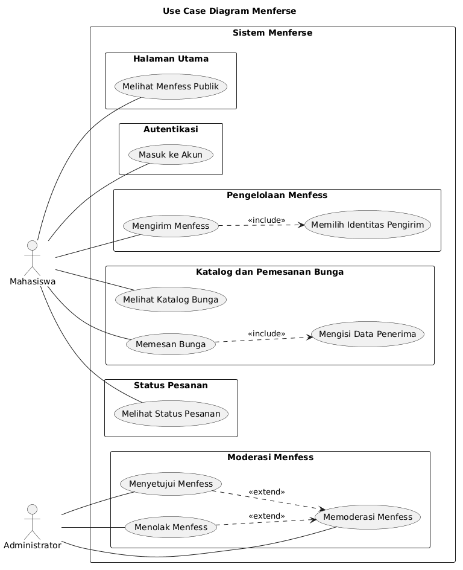

# D3: Use Case Diagram Menferse

## 1. Deskripsi Sistem

Menferse merupakan aplikasi berbasis web yang menyediakan layanan menfess kampus dan pemesanan bunga. Mahasiswa dapat mengirim menfess secara anonim maupun menggunakan identitas, melihat menfess yang telah dipublikasikan, serta memesan bunga untuk penerima di lingkungan kampus. Administrator bertanggung jawab memoderasi menfess sebelum ditampilkan kepada publik.

## 2. Aktor Sistem

### 2.1 Mahasiswa

Mahasiswa merupakan pengguna utama sistem yang dapat melihat menfess publik, masuk ke akun, mengirim menfess, melihat katalog bunga, memesan bunga, dan melihat status pesanan.

### 2.2 Administrator

Administrator bertanggung jawab mengelola proses moderasi menfess, termasuk memeriksa menfess, menyetujui menfess, dan menolak menfess yang tidak sesuai.

## 3. Daftar Use Case

| No. | Use Case | Aktor | Deskripsi |
|---|---|---|---|
| 1 | Melihat Menfess Publik | Mahasiswa | Melihat menfess yang telah dipublikasikan. |
| 2 | Masuk ke Akun | Mahasiswa | Melakukan autentikasi untuk mengakses fitur yang memerlukan login. |
| 3 | Mengirim Menfess | Mahasiswa | Mengirim pesan menfess melalui aplikasi. |
| 4 | Memilih Identitas Pengirim | Mahasiswa | Memilih untuk menampilkan identitas atau mengirim secara anonim. |
| 5 | Memoderasi Menfess | Administrator | Memeriksa menfess yang menunggu moderasi. |
| 6 | Menyetujui Menfess | Administrator | Menyetujui menfess agar dapat dipublikasikan. |
| 7 | Menolak Menfess | Administrator | Menolak menfess agar tidak dipublikasikan. |
| 8 | Melihat Katalog Bunga | Mahasiswa | Melihat pilihan bunga yang tersedia. |
| 9 | Memesan Bunga | Mahasiswa | Membuat pesanan bunga melalui aplikasi. |
| 10 | Mengisi Data Penerima | Mahasiswa | Mengisi nama penerima, program studi, angkatan, dan gedung kampus. |
| 11 | Melihat Status Pesanan | Mahasiswa | Melihat status pesanan bunga yang telah dibuat. |

## 4. Relasi Antar-Use Case

### 4.1 Relasi `<<include>>`

Relasi `<<include>>` menunjukkan bahwa suatu use case selalu melibatkan perilaku dari use case lainnya.

- **Mengirim Menfess** mencakup **Memilih Identitas Pengirim**.
- **Memesan Bunga** mencakup **Mengisi Data Penerima**.

### 4.2 Relasi `<<extend>>`

Relasi `<<extend>>` menunjukkan perilaku tambahan yang terjadi dalam kondisi tertentu.

- **Menyetujui Menfess** memperluas proses **Memoderasi Menfess**.
- **Menolak Menfess** memperluas proses **Memoderasi Menfess**.

## 5. Use Case Diagram

Diagram berikut menggambarkan hubungan antara aktor, fitur, dan sistem Menferse.

**Lokasi file PNG:** `diagrams/img/D3_USE_CASE_DIAGRAM.png`

**Lokasi source PlantUML:** `diagrams/D3_USE_CASE_DIAGRAM.puml`

## 6. Kesimpulan

Use Case Diagram Menferse menggambarkan interaksi antara mahasiswa dan administrator dengan fitur-fitur utama sistem. Diagram ini menjadi dasar untuk memahami kebutuhan fungsional aplikasi sebelum proses perancangan dan pengembangan lebih lanjut.
