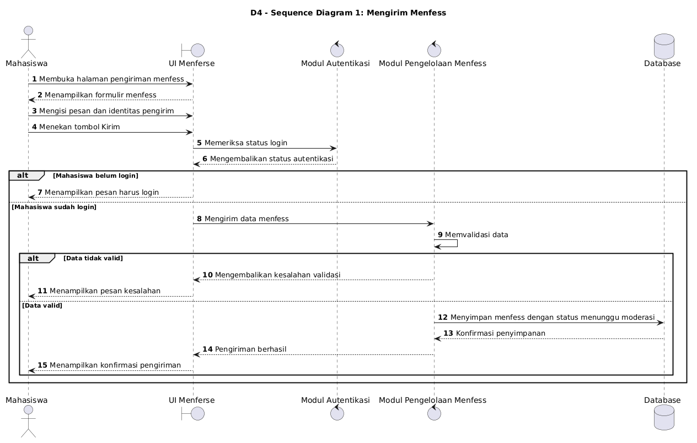
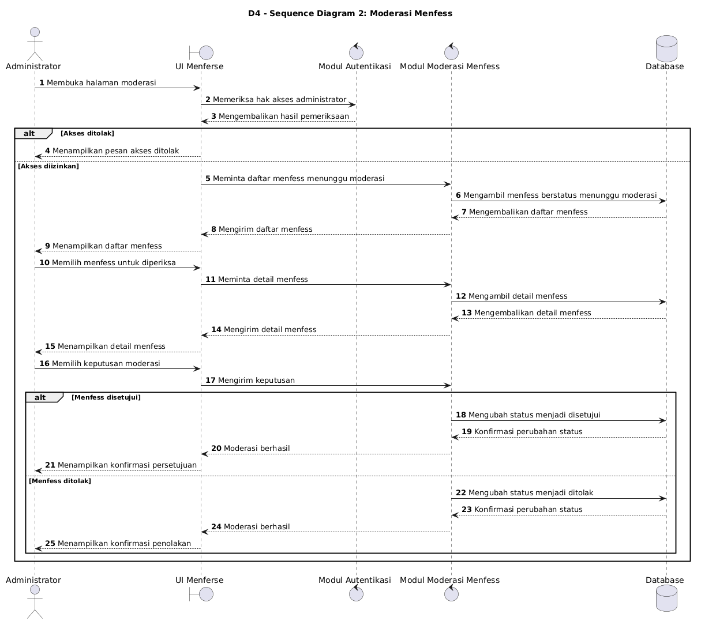
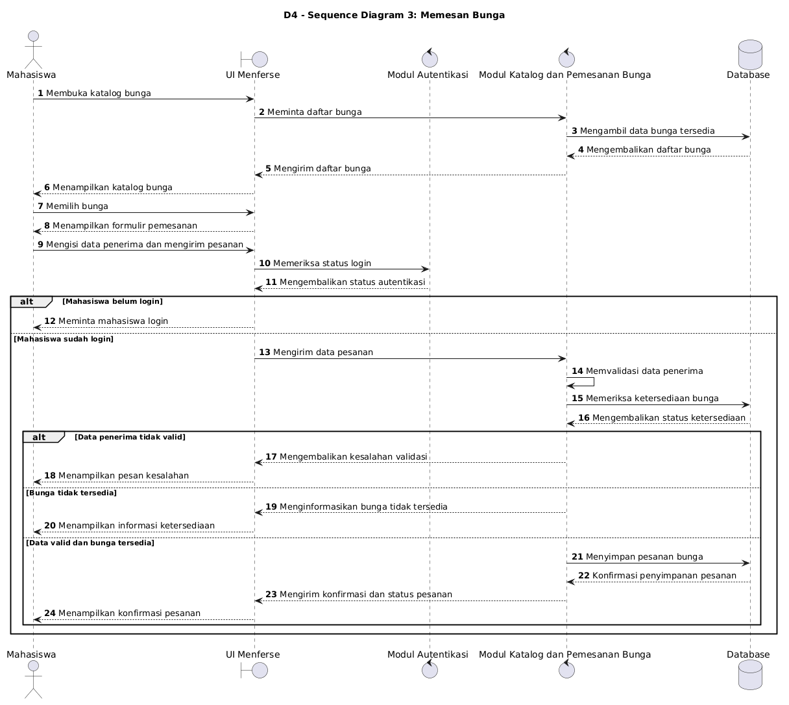

# D4: Sequence Diagrams Menferse

## 1. Tujuan

Sequence Diagram menggambarkan urutan interaksi antara aktor, antarmuka pengguna (*User Interface*), modul sistem, dan database. Dokumen ini mencakup tiga skenario utama Menferse: mengirim menfess, moderasi menfess, dan memesan bunga.

## 2. Sequence Diagram 1: Mengirim Menfess

### Deskripsi Skenario

Skenario ini menjelaskan proses mahasiswa mengirim menfess. Sistem memeriksa status login dan memvalidasi data sebelum menyimpan menfess dengan status menunggu moderasi.

Skenario ini penting karena menfess harus melewati proses moderasi sebelum ditampilkan kepada publik.

### Alur Proses

1. Mahasiswa membuka halaman pengiriman menfess.
2. Sistem menampilkan formulir menfess.
3. Mahasiswa mengisi pesan dan memilih identitas pengirim.
4. Sistem memeriksa status login mahasiswa.
5. Jika belum login, sistem meminta mahasiswa untuk login.
6. Jika sudah login, sistem memvalidasi data menfess.
7. Jika data tidak valid, sistem menampilkan pesan kesalahan.
8. Jika data valid, sistem menyimpan menfess dengan status menunggu moderasi.
9. Sistem menampilkan konfirmasi pengiriman.

### Diagram Sequence

**Lokasi file PNG:** `diagrams/img/D4_SEQUENCE_1.png`

**Lokasi source PlantUML:** `diagrams/D4_SEQUENCE_1.puml`

[**Lihat Source Code PlantUML D4 Sequence 1**](../diagrams/D4_SEQUENCE_1.puml)

### Hasil yang Diharapkan

Menfess berhasil disimpan dengan status menunggu moderasi dan tidak langsung muncul pada halaman publik.

## 3. Sequence Diagram 2: Moderasi Menfess

### Deskripsi Skenario

Skenario ini menjelaskan proses administrator memeriksa menfess yang menunggu moderasi dan menentukan apakah menfess disetujui atau ditolak.

Skenario ini penting untuk memastikan menfess yang dipublikasikan telah melalui proses pemeriksaan administrator.

### Alur Proses

1. Administrator membuka halaman moderasi.
2. Sistem memeriksa hak akses administrator.
3. Jika akses ditolak, sistem menampilkan pesan akses ditolak.
4. Jika akses diizinkan, sistem menampilkan daftar menfess yang menunggu moderasi.
5. Administrator memilih menfess untuk diperiksa.
6. Sistem menampilkan detail menfess.
7. Administrator menentukan keputusan moderasi.
8. Jika disetujui, sistem mengubah status menfess menjadi disetujui.
9. Jika ditolak, sistem mengubah status menfess menjadi ditolak.
10. Sistem menampilkan konfirmasi hasil moderasi.

### Diagram Sequence

**Lokasi file PNG:** `diagrams/img/D4_SEQUENCE_2.png`

**Lokasi source PlantUML:** `diagrams/D4_SEQUENCE_2.puml`

[**Lihat Source Code PlantUML D4 Sequence 2**](../diagrams/D4_SEQUENCE_2.puml)

### Hasil yang Diharapkan

Menfess yang disetujui dapat ditampilkan kepada publik, sedangkan menfess yang ditolak tidak dipublikasikan.

## 4. Sequence Diagram 3: Memesan Bunga

### Deskripsi Skenario

Skenario ini menjelaskan proses mahasiswa memilih bunga dari katalog dan membuat pesanan untuk penerima di lingkungan kampus. Sistem memeriksa autentikasi, memvalidasi data penerima, dan memeriksa ketersediaan bunga sebelum menyimpan pesanan.

Skenario ini penting untuk mengurangi kesalahan pemesanan dan memastikan informasi penerima valid.

### Alur Proses

1. Mahasiswa membuka katalog bunga.
2. Sistem menampilkan daftar bunga yang tersedia.
3. Mahasiswa memilih bunga.
4. Sistem menampilkan formulir pemesanan.
5. Mahasiswa mengisi nama penerima, program studi, angkatan, dan gedung kampus.
6. Sistem memeriksa status login mahasiswa.
7. Jika belum login, sistem meminta mahasiswa untuk login.
8. Jika sudah login, sistem memvalidasi data penerima.
9. Sistem memeriksa ketersediaan bunga.
10. Jika data tidak valid atau bunga tidak tersedia, sistem menampilkan pesan yang sesuai.
11. Jika data valid dan bunga tersedia, sistem menyimpan pesanan.
12. Sistem menampilkan konfirmasi dan status pesanan.

### Diagram Sequence

**Lokasi file PNG:** `diagrams/img/D4_SEQUENCE_3.png`

**Lokasi source PlantUML:** `diagrams/D4_SEQUENCE_3.puml`

[**Lihat Source Code PlantUML D4 Sequence 3**](../diagrams/D4_SEQUENCE_3.puml)

### Hasil yang Diharapkan

Pesanan berhasil disimpan apabila mahasiswa sudah login, data penerima valid, dan bunga tersedia. Jika persyaratan tidak terpenuhi, sistem menampilkan informasi yang sesuai.

## 5. Kesimpulan

Ketiga Sequence Diagram menjelaskan interaksi antara aktor, UI, modul sistem, dan database pada proses utama Menferse. Diagram juga menggambarkan kondisi alternatif, seperti autentikasi gagal, data tidak valid, akses ditolak, atau bunga tidak tersedia.
